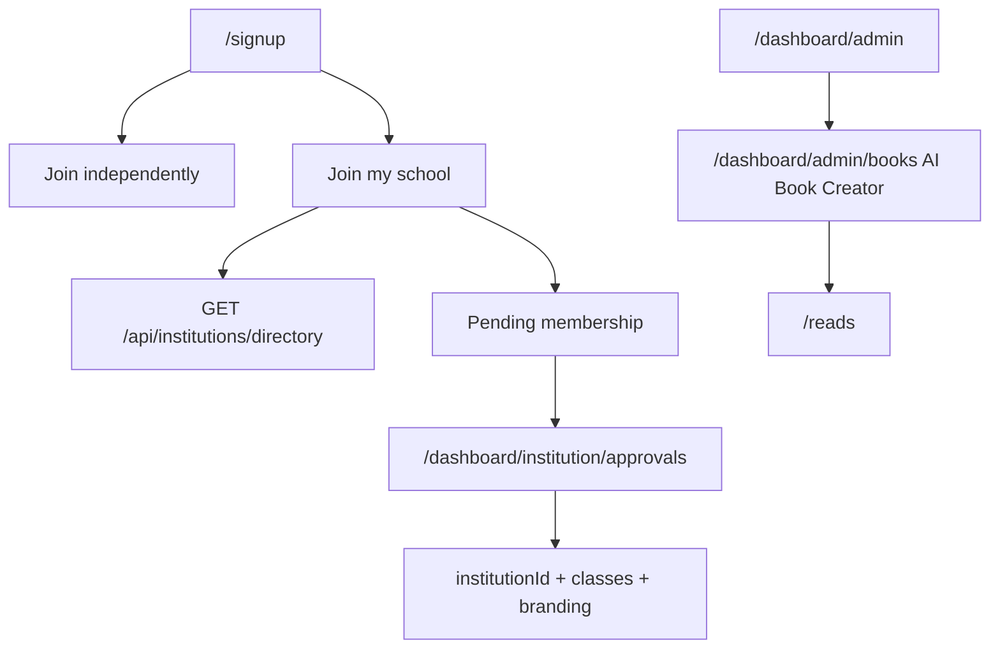

# Final audit

For Shahzar. No secret values. See also `HANDOVER.md` and `E2E_REPORT.md`.

## 1. Implemented features by area

- **Sign-up schools.** `/signup`. Public directory `GET /api/institutions/directory`. Membership `POST /api/institutions/membership`. Approvals `/dashboard/institution/approvals`. Pending badge in the dashboard sidebar.
- **AI Book Creator.** `/dashboard/admin/books` (`StudioView`, `lib/reads/creator.ts`). Nav key `nav.aiBookCreator`. Visible to `super_admin`, `admin`, and `content_editor` (platform `role: admin`). Teachers and institution admins with the CMS add-on get the same link at the top of their first nav group. Studio nav and the admin desk tools tile use the same name. AI generation already returns 503 when `OPENROUTER_API_KEY` is missing; the studio toasts that error.
- **Admin desk.** `GET/POST /api/admin/desk` checks the caller before any payload. Missing `FIREBASE_SERVICE_ACCOUNT` returns `setupNeeded` and the exact setup sentence, with no fake KPI zeros. Actions no-op in that state.
- **ET AI Studio.** `/dashboard/studio/et` is a full-page canvas in the dashboard shell (no nested frame). A missing model key shows the empty-reply line from `lib/studio/et-copy.ts`.
- **Teacher portraits.** `lib/teacher-portrait.ts` points each teacher id at `/teachers/{id}.svg`.
- **School wall.** Permission errors show a short unavailable message. Cause: wall rules are not deployed until the Firestore deploy in `HANDOVER.md`.

## 2. Fixed in this pass

| Bug | Fix |
| --- | --- |
| School dropdown only showed “My school isn’t listed” | Client Firestore read replaced by the public directory API. |
| Join path was not an explicit choice for students | “Join independently” and “Join my school” for student, teacher, and parent. |
| Left auth panel was a purple video | Brand blue gradient `#0B1417` → `#1E6A83` → `#3FE0D0`. |
| Admin desk returned zeros before auth | Auth first. Setup message when the server account is missing. |
| Book Studio looked like “Books” | Label `AI Book Creator` via `nav.aiBookCreator`, placed at the top of the admin nav. |
| Wall printed raw permission errors | `wallNotice` in `lib/wall/live.ts`. |

## 3. Pending or partial

| Item | What’s left |
| --- | --- |
| Landing v3 homepage and the linked marketing pages | Not replaced in this pass. |
| Copyright e-sign on instructor apply, course create, and course publish, plus `/dashboard/admin/declarations` | Declaration copy exists in `lib/courses/copyright.ts`. The immutable `copyright_declarations` record, admin retrieval, and every create path are not wired. |
| Admin planner month/week/day with drag and goal sync | Calendar helpers exist in `lib/planner/calendar.ts`. The page is still the limits form. |
| Consent defaults on at sign-up | `lib/consents.ts` exists. Sign-up still starts demographic consent off and still blocks when it is off. |
| Private classrooms (`visibility`, `class_invites`, student self-enrol) | Not wired. |
| Blog cover and inline images | Helpers in `lib/blog/images.ts`. The admin blog form is still a URL field. |
| Full role Playwright journeys | See `E2E_REPORT.md`. |
| Sidebar account menu clipping | `lib/ui/menu-position.ts` exists. The menu is still positioned inside the sidebar. |

## 4. Connectors

| Connector | Status | Env |
| --- | --- | --- |
| Firebase Auth / Firestore | Code-ready. Production rules not deployed from this branch. | Client config in `firebase-applet-config.json`. Server: `FIREBASE_SERVICE_ACCOUNT` |
| Storage | Code-ready. Needs Blaze and deployed `storage.rules`. | Same Firebase project |
| Rules and indexes | In git. Not deployed by this change. | Deploy command in `HANDOVER.md` |
| Stripe | Code-ready, keys missing on the server | `STRIPE_SECRET_KEY`, `STRIPE_WEBHOOK_SECRET` |
| Malaysian gateway | Code-ready, keys missing | `IPAY88_DUITNOW_PAYMENT_ID`, `PAYMENTS_SANDBOX` |
| MyInvois | Code-ready, keys missing | `MYINVOIS_CLIENT_ID`, `MYINVOIS_SECRET`, `MYINVOIS_TIN` or `TIN`, `MYINVOIS_ENV` |
| SMTP | Code-ready, keys missing. School invite records without sending. | `SMTP_HOST`, `SMTP_USER`, `SMTP_PASS` |
| Resend | Code-ready, key missing | `RESEND_API_KEY`, `MAIL_FROM` |
| WhatsApp | Code path exists | Provider credentials already used by the messaging module |
| Zoom / Meet / Teams | Not built as live rooms | Daily.co mentioned in copy; no env name is read |
| SAML / LTI | Flags exist; not turned on | `SCIM_BEARER_TOKEN` optional |
| FCM / Expo push | Code-ready | Push keys in the existing push module |
| ET AI (OpenRouter / Gemini) | Code-ready. Degrades when the key is missing. | `OPENROUTER_API_KEY` |
| OCR / speech | Partial. Speech falls back to typing in ET AI Studio. | Browser speech; no extra key |
| Vercel cron | Routes exist | `CRON_SECRET` |
| DNS poketschool.ai | Not changed here | Registrar / Vercel domains |

## 5. Known bugs still open

| Severity | Bug |
| --- | --- |
| High | Production Firestore rules are undeployed, so some client listeners still cannot read (wall, some desks) until the deploy command runs. |
| Medium | Copyright is not enforced on course create or publish. |
| Medium | Sign-up still requires demographic consent before continue. |
| Low | Account menu can clip on a narrow sidebar. The position helper is not wired. |

## 6. Wireframes

Sign-up, desktop: left blue gradient panel, right form. Role buttons, then Join independently | Join my school. School path: country, state, type-ahead, not-listed name, invite-school email, invite code.

Admin home: setup banner when the server account is missing; otherwise KPI cards and a tools grid whose first learning tile is AI Book Creator.

## 7. Mobile parity

The Expo app should mirror: public school search (do not query institutions before auth), pending-approval badge, approve/reject for institution admins, and the AI Book Creator entry for staff who have it on the web. Portraits are `/teachers/{id}.svg`.

## 8. Security

- Directory responses omit emails, billing, and admin ids.
- Membership writes go through the Admin SDK after `requireUser`. Decisions require platform admin or the institution owner.
- Invite-school is rate limited and does not require a session, because it runs before the account exists.
- Join requests stay `pending` until an admin or an allowed invite code approves them. The student cannot set `institutionId` from the client form.

## 9. Go-live checklist

1. Set `FIREBASE_SERVICE_ACCOUNT` on Vercel.
2. Deploy rules and indexes with the command in `HANDOVER.md`.
3. Confirm Institute and Enterprise academies have `status: active` and `listedForSelfJoin` or `publicListing`.
4. Set SMTP if school invites should send mail.
5. Set `OPENROUTER_API_KEY` for ET AI and book generation.
6. Set Stripe and the Malaysian gateway before taking payment.
7. Smoke `/signup` as student, teacher, and parent, then approve one request.
8. Open AI Book Creator as admin, generate or write a page, and confirm a missing key does not crash.

## ET AI Timetabler

Added beside the calendar, year planner, school desk, and attendance. It does not replace them. A published week writes class items the calendar and year planner can read, opens attendance registers, and can add classes on the sample school desk.

- Setup for days, periods, terms, holidays, rooms, staff, subjects, classes, sets, and option blocks, including CSV.
- Students and parents choose inside option blocks. ET AI suggests blocks, and approval creates sets and enrols the students.
- The week is placed by a deterministic solver. Hard constraints are never written. Quality and unmet soft constraints are stored. Plain language such as “Mr Chen can’t do Friday afternoons” is applied without a model key. `OPENROUTER_API_KEY` only adds a model paragraph on `POST /api/timetable/explain`.
- The grid rejects an illegal drag or click and offers a legal slot. Cover proposes a qualified free teacher, queues notices for the teachers, students, and parents, and keeps a cover load.
- Teacher add-on: personal timetable. Institution: one school. Enterprise: more than one campus. The price on the pricing page and the landing feature list is TBC by Harry.
- Firestore rules for `timetables` are in git and are not deployed from this work.
