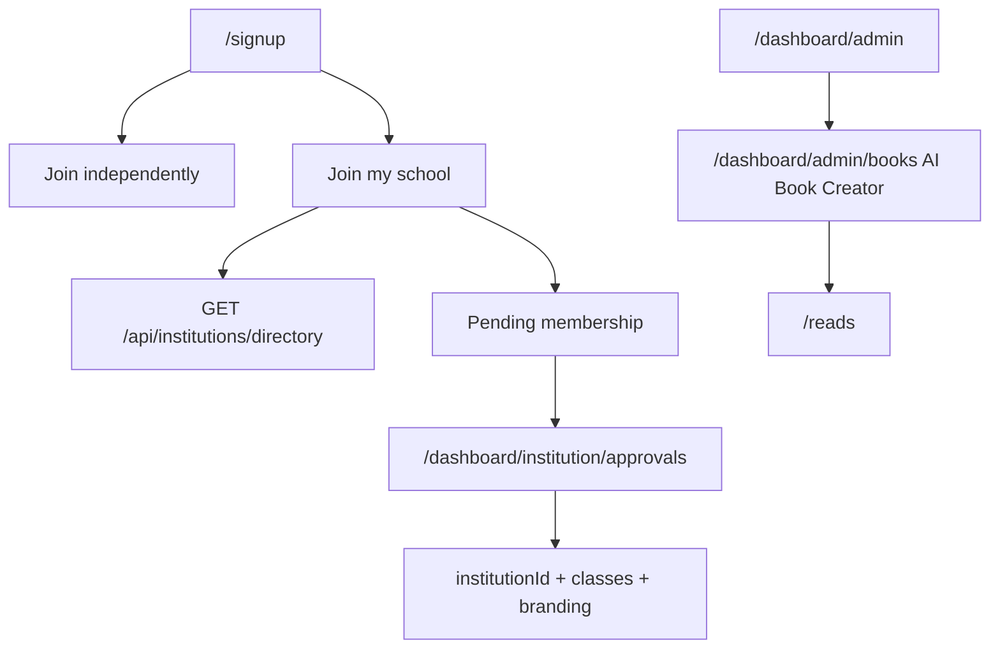

# Final audit

For Shahzar. No secret values. See also `HANDOVER.md`, `E2E_REPORT.md`, and `QA_QC.md`.

As of `main` `f9d395cb84d904c123b77abb599eea441e934bd8` (squash of #151, the dark full-screen ET AI Studio). That commit includes #148 at `de07f29b121001e80714bc839a914158a0e6d780` and #147 at `6a041278bf02fc27e62c1f0647581b5351ce3cbe`. Production deployment `dpl_14rQsk7dNuwsVEwsrWhBCVnP1VE6` is READY and aliased to https://pocket-school-ochre.vercel.app. Key names below are from the Vercel project `pocket-school` on 19 Oct 2026. Values were not read. Set and missing, per environment, is the table in `HANDOVER.md` (Start here).

## 1. Implemented features by area

#147 (on `main` since `6a04127`), #148 (on `main` since `de07f29`), and #151 (on `main` since `f9d395c`) are in this tree.

- **Sign-up schools.** `/signup`. Public directory `GET /api/institutions/directory`. Membership `POST /api/institutions/membership`. Approvals `/dashboard/institution/approvals`. Pending badge in the dashboard sidebar.
- **AI Book Creator.** `/dashboard/admin/books` (`StudioView`, `lib/reads/creator.ts`). Nav key `nav.aiBookCreator`. Visible to `super_admin`, `admin`, and `content_editor` (platform `role: admin`). Teachers and institution admins with the CMS add-on get the same link at the top of their first nav group. Studio nav and the admin desk tools tile use the same name. AI generation already returns 503 when `OPENROUTER_API_KEY` is missing; the studio toasts that error.
- **Admin desk.** `GET/POST /api/admin/desk` checks the caller before any payload. Missing `FIREBASE_SERVICE_ACCOUNT` returns `setupNeeded` and the exact setup sentence, with no fake KPI zeros. Actions no-op in that state.
- **ET AI Studio (#151).** The signed-in home at `/dashboard/studio`, and at `/ai-studio` (307 to that path), is the dark ET AI chat at full viewport (`data-studio-home="chat"`, `data-studio-layout="dark"`, `data-studio-immersive="1"`). The light dashboard sidebar, top bar, mobile nav, and floating tutor stay off this page and off `/dashboard/studio/et`. Dashboard is the first item in the dark sidebar, above New chat, and links to the role home (`/dashboard` for a student, then teacher, parent, institution, admin, or partner). Cyan `#3FE0D0` with ink `#203337`. The canvas stays dark when the site theme is light. The light card hub is one click away under All tools. Sidebar Tools lists AI Teachers, ET + Subject, ET Maths, ET Exams, ET Essays, Book Studio, the role desk, Planner, and Calendar once each. ET AI, PoketReads, AI Book Creator, and Creator Store stay on the empty-state chips and inside All tools. Timetabler is in that Tools list for teachers and institution admins only. Students do not see it. Maths, essays, exam prep, teachers, and the timetable grid still use the dashboard shell. A missing model key shows the empty-reply line from `lib/studio/et-copy.ts`. Recent essays stay on `/dashboard/studio/essays`.
- **Teacher portraits.** `lib/teacher-portrait.ts` maps each teacher id to a distinct `/teachers/et-<subject>.webp` headshot. Alt text is `ET <Subject>`. The public teachers page, studio teacher list, ET chat header, and the student dashboard picker all use that file. There is no SVG silhouette fallback.
- **Blog images.** Each post stores `coverImage` (1600×900 banner), `coverAlt`, and an optional `thumbnail` (the card uses the thumbnail, or a crop of the banner). Uploads go to Storage `blog/<postId>/` from `/dashboard/admin/blog`: drag-and-drop or picker, live preview, replace, remove, client resize to WebP. Alt text is required before publish. `/blog` cards show the thumbnail, title, excerpt, date, and reading time. `/blog/[slug]` is a full-width hero with the title on a blue gradient (`#1E6A83`, `#203337`, `#3FE0D0`). Open Graph and Twitter use the cover. A post with no cover omits `images` so `app/blog/[slug]/opengraph-image.tsx` draws the branded fallback. Seed covers in `public/blog/` are generated graphics, not photographs.
- **School wall.** Permission errors show a short unavailable message. Cause: wall rules are not deployed until the Firestore deploy in `HANDOVER.md`.

## 2. Fixed

| Bug | Fix |
| --- | --- |
| School dropdown only showed “My school isn’t listed” | Client Firestore read replaced by the public directory API. |
| Join path was not an explicit choice for students | “Join independently” and “Join my school” for student, teacher, and parent. |
| Left auth panel was a purple video | Brand blue gradient `#0B1417` → `#1E6A83` → `#3FE0D0`. |
| Admin desk returned zeros before auth | Auth first. Setup message when the server account is missing. |
| Book Studio looked like “Books” | Label `AI Book Creator` via `nav.aiBookCreator`, placed at the top of the admin nav. |
| Wall printed raw permission errors | `wallNotice` in `lib/wall/live.ts`. |
| Public pages hung Playwright | Promo banners, payment settings, and institution signup no longer call the Admin SDK when no server account is configured. |
| #148 would have dropped the #147 studio chat, portraits, and signatures | Squash `de07f29` keeps both. Studio home stays the ET AI chat. #151 makes that chat the full-screen dark home. Timetabler is an extra dark-sidebar link for teachers and institution or enterprise admins. |
| Calendar with no Google client | The desk stays unconfigured. iCal download and the signed feed still work. No page error. |
| Signed-out timetable URLs | Role routes 307 to `/dashboard/session`, then the client opens `/login` or `/admin/login`. `/dashboard/studio/timetable` is not in the middleware role list; the dashboard shell sends a signed-out visitor to `/login`. None of these returned 500 on production. |
| `/api/calendar/ics` with no token | 404. A trailing slash 308s to that path. A bad token returns 404 and the text “This calendar link is not active.” |

## 3. Pending or partial

| Item | What’s left |
| --- | --- |
| Landing v3 homepage and the linked marketing pages | Present. The homepage sets `data-landing="v3"`. Footer links open the marketing pages listed in the regression audit. |
| Copyright e-sign on instructor apply, course create, and course publish | The signature form is on instructor apply, course create, the teacher upload, the studio desk, and admin curriculum. A new course cannot be saved from the editor without a signature id. Admin retrieval is `/dashboard/admin/signatures`. A fresh signature was not submitted in this preview pass. |
| Admin planner month/week/day with drag and goal sync | The admin page still has the limits form and now also renders the calendar board. Student, parent, and teacher planner pages render the same board. Month, week, and day views are in the board. A drag-and-drop was not clicked in this pass. |
| Consent defaults on at sign-up | Done. Statistics, timezone, and Amber start checked. Clearing a box still allows sign-up. The value, time, and version are stored. |
| Private classrooms (`visibility`, class join, student self-enrol) | The teacher class form has “Who can join” (`data-class-visibility`). `/join/class/[code]` posts to the join API. A student self-enrol click was not completed in this pass. |
| Blog cover and inline images | Done in this pass. Admin upload, public cards, hero, and social images were checked on the local emulator. See `E2E_REPORT.md`. |
| Full role Playwright journeys | See `E2E_REPORT.md`. Several journeys are still open. |
| Sidebar account menu clipping | The menu now portals to `document.body` with `menuPosition`, so the sidebar no longer clips it. |
| Timetabler price | Stays `TBC by Harry` on `/pricing` and in `TIMETABLER_PRICE_NOTE`. Do not invent a number. |
| Timetable document in production Firestore | The desk the browser edits is stored in `localStorage` key `poket-timetable-v1`. Rules for `timetables` are in git and are not deployed. |
| Google Calendar OAuth | Key-blocked until the three `GOOGLE_*` names below are set. |
| Admin content | Publish the six blog drafts, mark featured courses, and merge duplicates. Steps are in the go-live checklist. The public journal and the featured carousel are empty because that content work has not been done. |

## 4. Connectors and keys

“Configured” means the name exists on the Vercel project. It does not mean the value was opened or proven.

| Connector | Status | Env |
| --- | --- | --- |
| Firebase Auth / Firestore | Client config is in `firebase-applet-config.json`. Server account is not configured. Production rules are not deployed. | `FIREBASE_SERVICE_ACCOUNT` absent |
| Firestore rules and indexes | In git. Not deployed. Command in `HANDOVER.md`. | No env name. Shahzar runs the deploy. |
| Storage | Code-ready. Journal files are `blog/<postId>/*.webp`. | Needs Blaze and deployed `storage.rules` |
| Firebase Blaze | Not verified in this pass. Storage and Functions still need the Blaze plan. | Billing, not an env name |
| Stripe | Publishable name is configured. Secret and webhook are not. | `NEXT_PUBLIC_STRIPE_PUBLISHABLE_KEY` configured. `STRIPE_SECRET_KEY` and `STRIPE_WEBHOOK_SECRET` absent |
| Malaysian gateway | Code-ready. Names absent. | `IPAY88_DUITNOW_PAYMENT_ID`, `PAYMENTS_SANDBOX` |
| MyInvois | Code-ready. Names absent. | `MYINVOIS_CLIENT_ID`, `MYINVOIS_SECRET`, `MYINVOIS_TIN` or `TIN`, `MYINVOIS_ENV` |
| SMTP | Code-ready. Names absent. Invites record and do not send. | `SMTP_HOST`, `SMTP_PORT`, `SMTP_USER`, `SMTP_PASS`, `SMTP_FROM` |
| Resend | Code-ready. Names absent. | `RESEND_API_KEY`, `MAIL_FROM`, `RESEND_WEBHOOK_SECRET` |
| OTP and session | `OTP_SECRET`, `DASHBOARD_SESSION_SECRET`, and `SUPER_ADMIN_EMAILS` are production only. `CARD_TOKEN_SECRET` and `CRON_SECRET` are also on preview. Development has none of these. | `OTP_SECRET` (also signs the iCal link), `DASHBOARD_SESSION_SECRET`, `CARD_TOKEN_SECRET`, `CRON_SECRET`, `SUPER_ADMIN_EMAILS` |
| ET AI | Names configured on production and preview. Solver does not need them. | `OPENROUTER_API_KEY`, `GEMINI_API_KEY`, `GOOGLE_API_KEY`. Also present: `API_KEY`, `VITE_GEMINI_API_KEY`, `VITE_GOOGLE_API_KEY` |
| Google Calendar OAuth | Not configured. iCal path works without them. | `GOOGLE_CLIENT_ID`, `GOOGLE_CLIENT_SECRET`, `GOOGLE_OAUTH_REDIRECT_URI` |
| Twilio | Names configured on production and preview. Live send was not smoked. | `TWILIO_ACCOUNT_SID`, `TWILIO_AUTH_TOKEN` |
| Zoom / Meet / Teams | Not built as live rooms | No `DAILY_*` name is read |
| SAML / LTI | Flags exist; not turned on | `SCIM_BEARER_TOKEN` optional, not in the env list |
| DNS poketschool.ai | Not attached. The only project domain is `pocket-school-ochre.vercel.app`. | Registrar / Vercel domains |

## 5. Known bugs still open

| Severity | Bug |
| --- | --- |
| High | Production Firestore rules are undeployed, and `FIREBASE_SERVICE_ACCOUNT` is absent, so admin desks and the school directory degrade and some client listeners (the wall, some desks) cannot read until both are done. |
| Medium | The timetable week a person edits lives in `localStorage` (`poket-timetable-v1`). It is not a production Firestore write yet. |
| Medium | A drag onto the planner board, a completed copyright signature write, and a live school-wall post were not exercised. |
| Low | `next build` on Next 15.5.15 flakes when Google Fonts returns an extension-less font URL. CI Playwright uses `next dev`. The production Vercel build of `f9d395c` still reached READY. |
| Data, not a code bug | `/blog` is an empty journal until the six drafts are published. Cover files under `/blog/*.webp` return 200. `/courses` lists 9 public items and `#featured` is empty until a course is marked featured. |

## 6. Wireframes



Sign-up, desktop: left blue gradient panel, right form. Role buttons, then Join independently | Join my school. School path: country, state, type-ahead, not-listed name, invite-school email, invite code.

Admin home: setup banner when the server account is missing; otherwise KPI cards and a tools grid whose first learning tile is AI Book Creator.

## 7. Mobile parity

The Expo app should mirror: public school search (do not query institutions before auth), pending-approval badge, approve/reject for institution admins, and the AI Book Creator entry for staff who have it on the web. Teacher portraits are `/teachers/et-<subject>.webp`.

## 8. Security

- Directory responses omit emails, billing, and admin ids.
- Membership writes go through the Admin SDK after `requireUser`. Decisions require platform admin or the institution owner.
- Invite-school is rate limited and does not require a session, because it runs before the account exists.
- Join requests stay `pending` until an admin or an allowed invite code approves them. The student cannot set `institutionId` from the client form.

## 9. Go-live checklist

Do these in order. Names only. Never paste values into git or into these docs.

1. Set `FIREBASE_SERVICE_ACCOUNT` on Vercel production, then redeploy. Until it is set, admin desks return the setup message and the school directory stays empty.
2. Confirm the Firebase project `ringed-sentinel-436615-c2` is on the Blaze plan. Storage uploads and Cloud Functions need it.
3. Deploy rules and indexes (Shahzar, not an agent session):

```bash
npx firebase deploy --only firestore:rules,firestore:indexes --project ringed-sentinel-436615-c2
```

Deploy `storage.rules` in the same change once Blaze is on.

4. Attach `poketschool.ai` on the Vercel project and point DNS at it. Today the live alias is https://pocket-school-ochre.vercel.app only.
5. Mail. Either set `SMTP_HOST`, `SMTP_PORT`, `SMTP_USER`, `SMTP_PASS`, and `SMTP_FROM`, or set `RESEND_API_KEY`, `MAIL_FROM`, and `RESEND_WEBHOOK_SECRET`. School invites stay as records until one of those paths can send. `OTP_SECRET` is already configured and also signs iCal links.
6. Payments. Set `STRIPE_SECRET_KEY` and `STRIPE_WEBHOOK_SECRET` before card charges. `NEXT_PUBLIC_STRIPE_PUBLISHABLE_KEY` is already configured. For the Malaysian rail set `IPAY88_DUITNOW_PAYMENT_ID` and `PAYMENTS_SANDBOX`. For e-invoice set `MYINVOIS_CLIENT_ID`, `MYINVOIS_SECRET`, `MYINVOIS_TIN` or `TIN`, and `MYINVOIS_ENV`.
7. ET AI names `OPENROUTER_API_KEY`, `GEMINI_API_KEY`, and `GOOGLE_API_KEY` are already configured. Smoke one studio reply and one book generation. The timetabler solver does not need them.
8. Google Calendar, after the Cloud Console steps in `HANDOVER.md`: set `GOOGLE_CLIENT_ID`, `GOOGLE_CLIENT_SECRET`, and `GOOGLE_OAUTH_REDIRECT_URI`. Until then the screen stays “Connect Google Calendar (not configured yet)” and iCal still works.
9. Admin content, signed in as a platform admin:
   - Publish the six journal drafts on `/dashboard/admin/blog`. `/blog` stays empty until that happens. Seed cover WebP files already return 200.
   - On `/dashboard/admin/placement`, set Marketplace to Listed and turn on Featured spot for each course that should lead the carousel. Only a published, listed course can take a spot. `/courses` currently shows 9 public items and an empty `#featured`.
   - Dedupe. Same titles are grouped on that page. Choose Keep and Hide after merge, then Merge duplicates, then Confirm merge. Enrolments move onto the kept course. The other course stays in the database and is hidden. A duplicate institution record is flagged “Duplicate institution record. Merge it in the academy admin before allocating both.” The schools desk has Merge duplicates for that.
10. Leave the timetabler price as `TBC by Harry` until Harry sets a number.
11. Confirm Institute and Enterprise academies that should appear on `/signup` have `status: active` and `listedForSelfJoin` or `publicListing`.
12. Smoke, signed out: `/`, `/about`, `/blog`, `/studio`, `/login`, `/courses` return 200. Timetable routes land on `/login` or `/admin/login`. `GET /api/calendar/ics` with no token is 404, not 500.
13. Smoke, signed in, after steps 1 and 3: admin desk shows real KPIs, one school request is approved, one timetable week is generated, one iCal subscription returns `BEGIN:VCALENDAR`.

## ET AI Timetabler

Added beside the calendar, year planner, school desk, and attendance. It does not replace them. A published week writes class items the calendar and year planner can read, opens attendance registers, and can add classes on the sample school desk.

- Setup for days, periods, terms, holidays, rooms, staff, subjects, classes, sets, and option blocks, including CSV.
- Students and parents choose inside option blocks. ET AI suggests blocks, and approval creates sets and enrols the students.
- The week is placed by a deterministic solver. Hard constraints are never written. Quality and unmet soft constraints are stored. Plain language such as “Mr Chen can’t do Friday afternoons” is applied without a model key. `OPENROUTER_API_KEY` only adds a model paragraph on `POST /api/timetable/explain`.
- The grid rejects an illegal drag or click and offers a legal slot. Cover proposes a qualified free teacher, queues notices for the teachers, students, and parents, and keeps a cover load.
- Teacher add-on: personal timetable. Institution: one school. Enterprise: more than one campus. The price on the pricing page and the landing feature list is TBC by Harry.
- The week the desk edits is stored in the browser (`poket-timetable-v1` in `lib/timetable/store.ts`). Firestore rules for `timetables` are in git and are not deployed. Attendance registers stay unmarked until a real register is taken. Cover notices use the in-app notification path. Print is the browser print dialog.
- The teacher sidebar opens `/dashboard/teacher/timetable`. The institution and enterprise admin sidebar opens `/dashboard/institution/timetable`. AI Studio keeps the dark ET AI chat from #151. Teachers and institution or enterprise admins also get Timetabler in the dark sidebar Tools list, opening `/dashboard/studio/timetable`. Students do not see that entry. Without the add-on the grid is an upsell and the price stays TBC by Harry. ET AI can draft a week, cover, a room fix, or extra periods from a sentence or a photo, and nothing is saved until confirm. The full grid still uses the dashboard shell. The edited week is still `localStorage` (`poket-timetable-v1`). Persisting it to Firestore is a TODO.
- Google Calendar is additive. Missing `GOOGLE_CLIENT_ID`, `GOOGLE_CLIENT_SECRET`, or `GOOGLE_OAUTH_REDIRECT_URI` leaves the iCal download and the signed subscription working, and the screen says Connect Google Calendar (not configured yet).

## 10. Regression audit

#148, compared with `main` at `6a041278bf02fc27e62c1f0647581b5351ce3cbe`: no `app/**/page.tsx` file from that commit was missing, and no sidebar `href` from `app/dashboard/layout.tsx` on that commit was removed. Pages added then: `/dashboard/admin/timetable`, `/dashboard/institution/timetable`, `/dashboard/parent/timetable`, `/dashboard/student/timetable`, `/dashboard/studio/timetable`, `/dashboard/teacher/timetable`, `/preview/studio`, `/preview/timetable`.

#151 keeps those pages. It changes the signed-in studio home. `/dashboard/studio` and `/ai-studio` are a full-viewport dark chat. The light dashboard chrome is not on that home. Dashboard is the first dark-sidebar item. The light card hub is behind All tools. Timetabler sits in the dark sidebar Tools list for teachers and institution admins, not in a studio header, and students do not see it. Product work stays additive: do not delete a page or a sidebar link to land a new tool.

`/preview/scope-c` stays closed on a production server unless `SCOPE_PREVIEW=1`. `/preview/institution-console` stays closed unless `INSTITUTION_PREVIEW=1`.

## 11. Production smoke of `f9d395c`

Deployment `dpl_14rQsk7dNuwsVEwsrWhBCVnP1VE6`, state READY, target production, commit `f9d395cb84d904c123b77abb599eea441e934bd8`. Alias https://pocket-school-ochre.vercel.app.

Playwright `e2e/roles.spec.ts` “marketing pages from the landing footer answer” against that origin, with `E2E_EMULATOR=1`: 1 passed. Homepage `data-landing="v3"`, no `#c8820a`, no “Years 1”.

| Check | Result |
| --- | --- |
| `/`, `/about`, `/studio`, `/login` | 200, heading visible, no page error |
| `/blog` | 200. Heading “The journal”. Copy still says the drafts stay unpublished |
| `/courses` | 200. Nine public listings. `#featured` is present and empty |
| `/dashboard/studio` | First response 200. The shell then sends the signed-out visitor to `/login`. No page error |
| `/ai-studio` | 307 to `/dashboard/studio`, then the same clean redirect to `/login` |
| `/dashboard/admin/books` | 307 to `/dashboard/session`, then `/admin/login` |
| `/dashboard/admin/placement` | 307 to `/dashboard/session`, then `/admin/login` |
| Teacher, institution, student, and parent timetable | 307 to `/dashboard/session?next=…`, then `/login`. No page error |
| `/dashboard/admin/timetable` | 307, then `/admin/login` |
| `/dashboard/studio/timetable` | 200 shell, then the dashboard sends the signed-out visitor to `/login` |
| `GET /api/calendar/ics` | 404, not 500. A trailing slash 308s to that path. A bad token is 404 with “This calendar link is not active.” |

Screenshots from this pass: `prod-home.png`, `prod-blog.png`, `prod-courses.png`.

## Earlier production smoke of `de07f29`

Deployment `dpl_3oPXzYfPsmmboz57ZWERLteTDhHL`, state READY, target production, commit `de07f29b121001e80714bc839a914158a0e6d780`. Aliases include https://pocket-school-ochre.vercel.app.

Playwright `e2e/roles.spec.ts` “marketing pages from the landing footer answer” against that origin: 1 passed. Homepage `data-landing="v3"`, no `#c8820a`, no “Years 1”.

| Check | Result |
| --- | --- |
| `/`, `/about`, `/studio`, `/login` | 200, heading visible, no page error |
| `/blog` | 200. Heading “The journal”. Copy says the six drafts stay unpublished. Cover WebP files under `/blog/` return 200 image/webp |
| `/courses` | 200. Nine public listings. `#featured` is empty |
| `/dashboard/admin/books` | 307 to `/dashboard/session`, then `/login` |
| `/dashboard/admin/placement` | 307 to `/dashboard/session`, then `/admin/login` |
| Teacher, institution, student, and parent timetable | 307 to `/dashboard/session?next=…`, then `/login`. No page error |
| `/dashboard/admin/timetable` | 307, then `/admin/login` |
| `/dashboard/studio/timetable` | 200 shell, then the dashboard sends the signed-out visitor to `/login` |
| `GET /api/calendar/ics` and `/api/calendar/ics/` | 404 (the slash 308s first). Not 500 |
| `GET /api/calendar/ics/not-a-token` | 404, body “This calendar link is not active.” |
