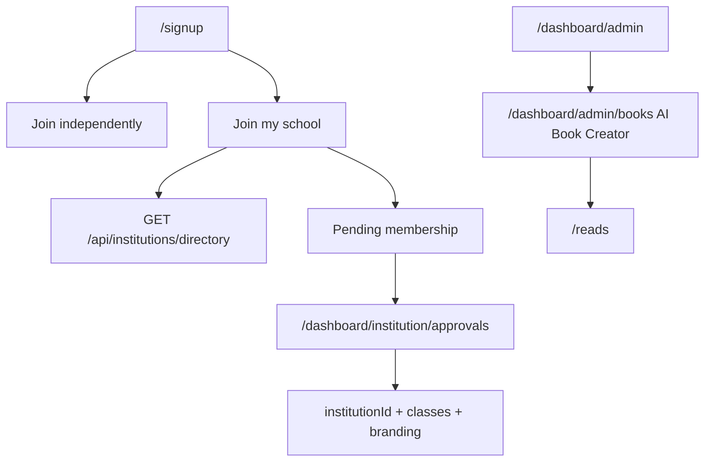

# Final audit

For Shahzar. No secret values. See also `HANDOVER.md` and `E2E_REPORT.md`.

## 1. Implemented features by area

- **Sign-up schools.** `/signup`. Public directory `GET /api/institutions/directory`. Membership `POST /api/institutions/membership`. Approvals `/dashboard/institution/approvals`. Pending badge in the dashboard sidebar.
- **AI Book Creator.** `/dashboard/admin/books` (`StudioView`, `lib/reads/creator.ts`). Nav key `nav.aiBookCreator`. Visible to `super_admin`, `admin`, and `content_editor` (platform `role: admin`). Teachers and institution admins with the CMS add-on get the same link at the top of their first nav group. Studio nav and the admin desk tools tile use the same name. AI generation already returns 503 when `OPENROUTER_API_KEY` is missing; the studio toasts that error.
- **Admin desk.** `GET/POST /api/admin/desk` checks the caller before any payload. Missing `FIREBASE_SERVICE_ACCOUNT` returns `setupNeeded` and the exact setup sentence, with no fake KPI zeros. Actions no-op in that state.
- **ET AI Studio.** `/dashboard/studio` and its sub-pages sit in the dashboard shell only. Section links are a horizontal header (`data-studio-nav="header"`), not a second sidebar. The home is the ET AI chat (`data-studio-home="chat"`). Header tabs open AI Studio, ET AI, AI Teachers, ET Maths, ET Exams, ET Essays, Creator Store, and AI Book Creator. A missing model key shows the empty-reply line from `lib/studio/et-copy.ts`. Recent essays stay on `/dashboard/studio/essays`.
- **Teacher portraits.** `lib/teacher-portrait.ts` maps each teacher id to a distinct `/teachers/et-<subject>.webp` headshot. Alt text is `ET <Subject>`. The public teachers page, studio teacher list, ET chat header, and the student dashboard picker all use that file. There is no SVG silhouette fallback.
- **Blog images.** Each post stores `coverImage` (1600×900 banner), `coverAlt`, and an optional `thumbnail` (the card uses the thumbnail, or a crop of the banner). Uploads go to Storage `blog/<postId>/` from `/dashboard/admin/blog`: drag-and-drop or picker, live preview, replace, remove, client resize to WebP. Alt text is required before publish. `/blog` cards show the thumbnail, title, excerpt, date, and reading time. `/blog/[slug]` is a full-width hero with the title on a blue gradient (`#1E6A83`, `#203337`, `#3FE0D0`). Open Graph and Twitter use the cover. A post with no cover omits `images` so `app/blog/[slug]/opengraph-image.tsx` draws the branded fallback. Seed covers in `public/blog/` are generated graphics, not photographs.
- **School wall.** Permission errors show a short unavailable message. Cause: wall rules are not deployed until the Firestore deploy in `HANDOVER.md`.

## 2. Fixed in this pass

| Bug | Fix |
| --- | --- |
| School dropdown only showed “My school isn’t listed” | Client Firestore read replaced by the public directory API. |
| Join path was not an explicit choice for students | “Join independently” and “Join my school” for student, teacher, and parent. |
| Left auth panel was a purple video | Brand blue gradient `#0B1417` → `#1E6A83` → `#3FE0D0`. |
| Admin desk returned zeros before auth | Auth first. Setup message when the server account is missing. |
| Book Studio looked like “Books” | Label `AI Book Creator` via `nav.aiBookCreator`, placed at the top of the admin nav. |
| Wall printed raw permission errors | `wallNotice` in `lib/wall/live.ts`. |
| Public pages hung Playwright | Promo banners, payment settings, and institution signup no longer call the Admin SDK when no server account is configured. |

## 3. Pending or partial

| Item | What’s left |
| --- | --- |
| Landing v3 homepage and the linked marketing pages | Present. The homepage sets `data-landing="v3"`. Footer links open the marketing pages listed in the regression audit. |
| Copyright e-sign on instructor apply, course create, and course publish | The signature form is on instructor apply, course create, the teacher upload, the studio desk, and admin curriculum. A new course cannot be saved from the editor without a signature id. Admin retrieval is `/dashboard/admin/signatures`. A fresh signature was not submitted in this preview pass. |
| Admin planner month/week/day with drag and goal sync | The admin page still has the limits form and now also renders the calendar board. Student, parent, and teacher planner pages render the same board. Month, week, and day views are in the board. A drag-and-drop was not clicked in this pass. |
| Consent defaults on at sign-up | Done. Statistics, timezone, and Amber start checked. Clearing a box still allows sign-up. The value, time, and version are stored. |
| Private classrooms (`visibility`, class join, student self-enrol) | The teacher class form has “Who can join” (`data-class-visibility`). `/join/class/[code]` posts to the join API. A student self-enrol click was not completed in this pass. |
| Blog cover and inline images | Done in this pass. Admin upload, public cards, hero, and social images were checked on the local emulator. See `E2E_REPORT.md`. |
| Full role Playwright journeys | See `E2E_REPORT.md`. |
| Sidebar account menu clipping | The menu now portals to `document.body` with `menuPosition`, so the sidebar no longer clips it. |

## 4. Connectors

| Connector | Status | Env |
| --- | --- | --- |
| Firebase Auth / Firestore | Code-ready. Production rules not deployed from this branch. | Client config in `firebase-applet-config.json`. Server: `FIREBASE_SERVICE_ACCOUNT` |
| Storage | Code-ready. Journal files are `blog/<postId>/*.webp` (public read, signed-in WebP write under 5 MB). Needs Blaze and deployed `storage.rules`. | Same Firebase project |
| Rules and indexes | In git. Not deployed by this change. | Deploy command in `HANDOVER.md` |
| Stripe | Code-ready, keys missing on the server | `STRIPE_SECRET_KEY`, `STRIPE_WEBHOOK_SECRET` |
| Malaysian gateway | Code-ready, keys missing | `IPAY88_DUITNOW_PAYMENT_ID`, `PAYMENTS_SANDBOX` |
| MyInvois | Code-ready, keys missing | `MYINVOIS_CLIENT_ID`, `MYINVOIS_SECRET`, `MYINVOIS_TIN` or `TIN`, `MYINVOIS_ENV` |
| SMTP | Code-ready, keys missing. School invite records without sending. | `SMTP_HOST`, `SMTP_USER`, `SMTP_PASS` |
| Resend | Code-ready, key missing | `RESEND_API_KEY`, `MAIL_FROM` |
| WhatsApp | Code path exists | Provider credentials already used by the messaging module |
| Zoom / Meet / Teams | Not built as live rooms | Daily.co mentioned in copy; no env name is read |
| SAML / LTI | Flags exist; not turned on | `SCIM_BEARER_TOKEN` optional |
| FCM / Expo push | Code-ready | Push keys in the existing push module |
| ET AI (OpenRouter / Gemini) | Code-ready. Degrades when the key is missing. | `OPENROUTER_API_KEY` |
| OCR / speech | Partial. Speech falls back to typing in ET AI Studio. | Browser speech; no extra key |
| Vercel cron | Routes exist | `CRON_SECRET` |
| DNS poketschool.ai | Not changed here | Registrar / Vercel domains |

## 5. Known bugs still open

| Severity | Bug |
| --- | --- |
| High | Production Firestore rules are undeployed, so some client listeners still cannot read (wall, some desks) until the deploy command runs. |
| Medium | A drag onto the planner board, a completed copyright signature write, and a live school-wall post were not exercised in this preview pass. |

## 6. Wireframes

Sign-up, desktop: left blue gradient panel, right form. Role buttons, then Join independently | Join my school. School path: country, state, type-ahead, not-listed name, invite-school email, invite code.

Admin home: setup banner when the server account is missing; otherwise KPI cards and a tools grid whose first learning tile is AI Book Creator.

## 7. Mobile parity

The Expo app should mirror: public school search (do not query institutions before auth), pending-approval badge, approve/reject for institution admins, and the AI Book Creator entry for staff who have it on the web. Teacher portraits are `/teachers/et-<subject>.webp`.

## 8. Security

- Directory responses omit emails, billing, and admin ids.
- Membership writes go through the Admin SDK after `requireUser`. Decisions require platform admin or the institution owner.
- Invite-school is rate limited and does not require a session, because it runs before the account exists.
- Join requests stay `pending` until an admin or an allowed invite code approves them. The student cannot set `institutionId` from the client form.

## 9. Go-live checklist

1. Set `FIREBASE_SERVICE_ACCOUNT` on Vercel.
2. Deploy rules and indexes with the command in `HANDOVER.md`.
3. Confirm Institute and Enterprise academies have `status: active` and `listedForSelfJoin` or `publicListing`.
4. Set SMTP if school invites should send mail.
5. Set `OPENROUTER_API_KEY` for ET AI and book generation.
6. Set Stripe and the Malaysian gateway before taking payment.
7. Smoke `/signup` as student, teacher, and parent, then approve one request.
8. Open AI Book Creator as admin, generate or write a page, and confirm a missing key does not crash.

## 10. Regression audit

Compared with `main` at `018d413` (merge-base of this branch; `origin/main` has no newer commits). Nothing that `main` still ships was removed from the route table or the sidebar. No files were restored, because the only deletions are the old teacher portraits.

### Pages

`main` has 306 `app/**/page.tsx` files. This branch has 326. None of the old pages are missing. Pages added:

`/about`, `/alevel`, `/dashboard/admin/signatures`, `/dashboard/parent/planner`, `/dashboard/student/planner`, `/dashboard/teacher/planner`, `/demo`, `/id`, `/igcse`, `/independent`, `/institutions`, `/join/class/[code]`, `/llb`, `/mbbs`, `/primary`, `/privacy`, `/rochfords`, `/safeline`, `/studio`, `/terms`.

### Files deleted or reduced

Deleted, and not restored: 36 `public/teachers/et-*.svg` silhouettes and 6 `public/teachers/portrait-*.jpg` files (`arts`, `coach`, `english`, `humanities`, `maths`, `science`). Each SVG stem has a matching `public/teachers/et-*.webp` (36 files). `lib/teacher-portrait.ts` maps every teacher id to `/teachers/et-<subject>.webp`. The six JPGs are not referenced in source. This is the portrait replacement, not a missing asset.

The only source file that shrank by more than a few lines is `app/dashboard/studio/page.tsx` (113 lines to 15). The old page was a gold-tinted hero (`rgba(226,175,77)`), prompt chips, the tool grid, and a recent-essays strip. The new page is the ET AI chat under “What should ET AI make today”. The gold hero is not restored. The tool grid remains on `/preview/studio-desk`. Essays remain on `/dashboard/studio/essays`. Header tabs are `StudioNav` in `app/dashboard/studio/layout.tsx`.

### Sidebar links by role

`app/dashboard/layout.tsx` against `018d413`: no href removed. Added `/dashboard/admin/signatures` and `/dashboard/student/tasks`. Home tiles in `lib/dashboard/home.ts`: no href removed. Added `/dashboard/student/planner`, `/dashboard/parent/planner`, and `/dashboard/teacher/planner`. Those three planner pages are opened from the home tiles and by URL. They are not in the persistent sidebar. They were not on `main` either.

Alumni and recruiter are home tiles, not a `Role` in the sidebar map.

Student (47): `/dashboard/student`, `/dashboard/student/perks`, `/dashboard/notes`, `/dashboard/studio`, `/ai-teachers`, `/dashboard/student/learning`, `/courses`, `/reads`, `/dashboard/student/courses`, `/dashboard/student/live`, `/dashboard/messages`, `/dashboard/student/achievements`, `/dashboard/student/assignments`, `/dashboard/student/exams`, `/dashboard/student/transcript`, `/dashboard/student/attendance`, `/dashboard/student/certificates`, `/dashboard/student/tasks`, `/dashboard/student/goals`, `/dashboard/student/analytics`, `/dashboard/student/progress`, `/dashboard/behaviour`, `/dashboard/student/integrity`, `/dashboard/reports`, `/dashboard/student/billing`, `/dashboard/student/academy`, `/dashboard/student/network`, `/dashboard/student/yearbook`, `/dashboard/student/career`, `/dashboard/wallet`, `/dashboard/referrals`, `/dashboard/community`, `/dashboard/network`, `/dashboard/tutors`, `/dashboard/exam-centre`, `/dashboard/studio/et`, `/dashboard/studio/teachers`, `/dashboard/studio/maths`, `/dashboard/studio/exam-prep`, `/dashboard/studio/essays`, `/dashboard/store`, `/dashboard/announcements`, `/dashboard/calendar`, `/dashboard/resources`, `/dashboard/helpdesk`, `/dashboard/card`, `/dashboard/profile`.

Teacher (43): `/dashboard/teacher`, `/dashboard/studio`, `/dashboard/teacher/classes`, `/dashboard/teacher/courses`, `/courses`, `/reads`, `/dashboard/teacher/earnings`, `/dashboard/wallet`, `/dashboard/referrals`, `/dashboard/messages`, `/dashboard/teacher/hotline`, `/dashboard/teacher/analytics`, `/dashboard/teacher/insights`, `/dashboard/teacher/progress`, `/dashboard/teacher/goals`, `/dashboard/teacher/references`, `/dashboard/teacher/gradebook`, `/dashboard/teacher/assignments`, `/dashboard/teacher/exams`, `/dashboard/teacher/report-cards`, `/dashboard/teacher/report-studio`, `/dashboard/teacher/attendance`, `/dashboard/teacher/live`, `/dashboard/teacher/integrity`, `/dashboard/teacher/integrity/cases`, `/dashboard/reports`, `/dashboard/behaviour`, `/dashboard/teacher/behaviour`, `/dashboard/community`, `/dashboard/network`, `/dashboard/tutors`, `/dashboard/exam-centre`, `/dashboard/studio/et`, `/dashboard/studio/teachers`, `/dashboard/studio/maths`, `/dashboard/studio/exam-prep`, `/dashboard/studio/essays`, `/dashboard/store`, `/dashboard/announcements`, `/dashboard/calendar`, `/dashboard/resources`, `/dashboard/card`, `/dashboard/profile`.

Parent (24): `/dashboard/parent`, `/dashboard/parent#certificates`, `/dashboard/messages`, `/dashboard/studio`, `/courses`, `/reads`, `/dashboard/parent/hotline`, `/dashboard/parent/communications`, `/dashboard/parent/duedates`, `/dashboard/wallet`, `/dashboard/referrals`, `/dashboard/parent/goals`, `/dashboard/parent/analytics`, `/dashboard/parent/progress`, `/dashboard/behaviour`, `/dashboard/parent/integrity`, `/dashboard/parent/reports`, `/dashboard/reports`, `/dashboard/parent/controls`, `/dashboard/announcements`, `/dashboard/calendar`, `/dashboard/helpdesk`, `/dashboard/card`, `/dashboard/profile`.

Admin (51 entries, 50 unique; Insights is listed twice): `/dashboard/admin`, `/dashboard/admin/books`, `/dashboard/admin/queues`, `/dashboard/admin/platform`, `/dashboard/admin/pulse`, `/dashboard/admin/safety-desk`, `/dashboard/admin/blog`, `/dashboard/studio`, `/dashboard/admin/courses`, `/dashboard/admin/placement`, `/dashboard/admin/help`, `/dashboard/admin/curriculum`, `/dashboard/admin/planner`, `/dashboard/admin/signatures`, `/courses`, `/reads`, `/dashboard/admin/users`, `/dashboard/admin/institutions`, `/dashboard/admin/schools`, `/dashboard/admin/insights`, `/dashboard/admin/automation`, `/dashboard/admin/access`, `/dashboard/admin/allocations`, `/dashboard/messages`, `/dashboard/admin/settings`, `/dashboard/admin/verifications`, `/dashboard/admin/partners`, `/dashboard/admin/activity`, `/dashboard/admin/certificates`, `/dashboard/admin/badges`, `/dashboard/reports`, `/dashboard/admin/hotline`, `/dashboard/admin/emergency`, `/dashboard/admin/moderation`, `/dashboard/community`, `/dashboard/network`, `/dashboard/tutors`, `/dashboard/store`, `/dashboard/admin/payments`, `/dashboard/admin/integrations`, `/dashboard/admin/finance`, `/dashboard/wallet`, `/dashboard/referrals`, `/dashboard/announcements`, `/dashboard/calendar`, `/dashboard/resources`, `/dashboard/teacher/billing`, `/dashboard/helpdesk`, `/dashboard/card`, `/dashboard/profile`.

Institution admin (30): `/dashboard/institution`, `/dashboard/institution/insights`, `/dashboard/institution/approvals`, `/dashboard/institution/join`, `/dashboard/institution/alumni`, `/dashboard/institution/career`, `/dashboard/institution/verify`, `/dashboard/institution/publishing`, `/dashboard/institution/sparks`, `/dashboard/institution/billing`, `/dashboard/institution/usage`, `/dashboard/institution/onboarding`, `/dashboard/admin/institutions`, `/dashboard/studio`, `/courses`, `/reads`, `/dashboard/messages`, `/dashboard/reports`, `/dashboard/behaviour`, `/dashboard/institution/templates`, `/dashboard/institution/activity`, `/dashboard/institution/progress`, `/dashboard/institution/goals`, `/dashboard/institution/certificates`, `/dashboard/institution/hotline`, `/dashboard/institution/emergency`, `/dashboard/announcements`, `/dashboard/calendar`, `/dashboard/card`, `/dashboard/profile`.

Partner merchant (4): `/dashboard/partner`, `/partner`, `/dashboard/card`, `/dashboard/profile`.

Public marketing links in `lib/marketing/nav.ts`: `/ai-teachers`, `/studio`, `/reads`, `/safeline`, `/id`, `/primary`, `/igcse`, `/alevel`, `/llb`, `/mbbs`, `/independent`, `/institutions`, `/institutions/register`, `/demo`, `/about`, `/rochfords`, `/privacy`, `/terms`.

### Relation to main and to PR 148

No rebase or merge was required. `origin/main` is still `018d413`. PR 148 (`cursor/et-ai-timetabler-336c`) is based on that same commit and does not contain these handover commits. It stays a separate draft. It does not depend on this branch.

`/preview/scope-c` stays closed on a production server unless `SCOPE_PREVIEW=1`. `/preview/institution-console` stays closed unless `INSTITUTION_PREVIEW=1`. The route smoke set both flags on the preview server. A normal production start still returns 404 for those two galleries.
